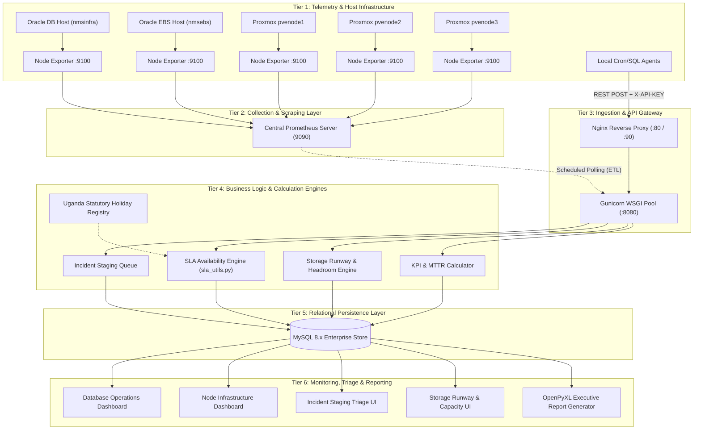
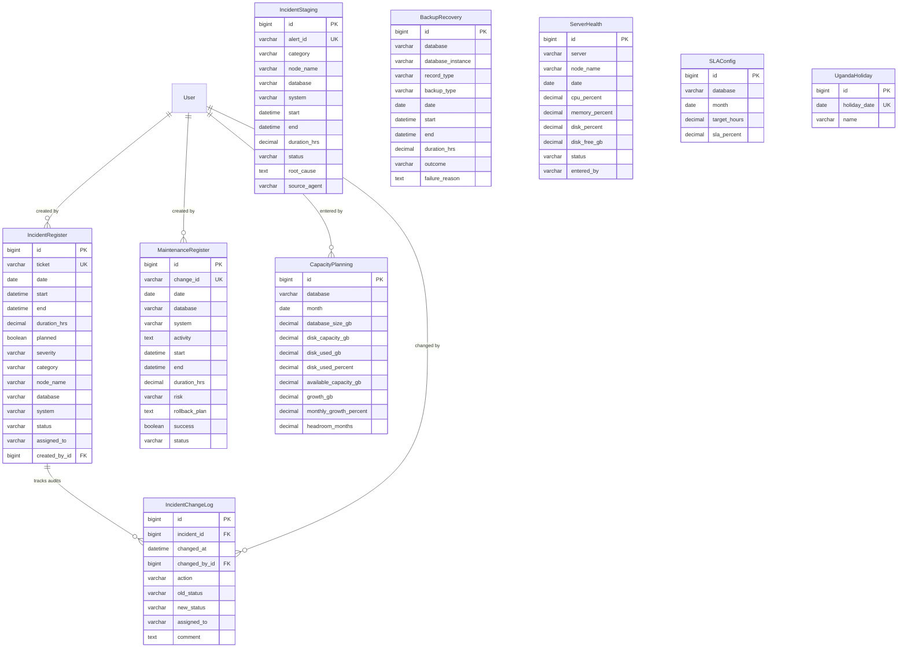
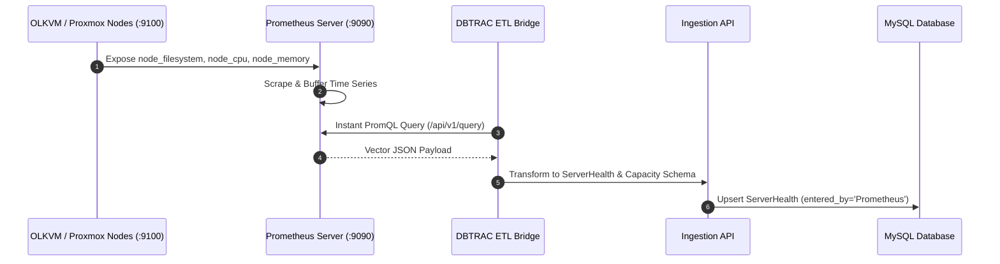
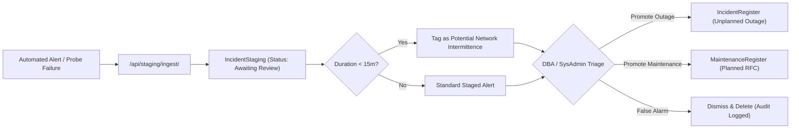
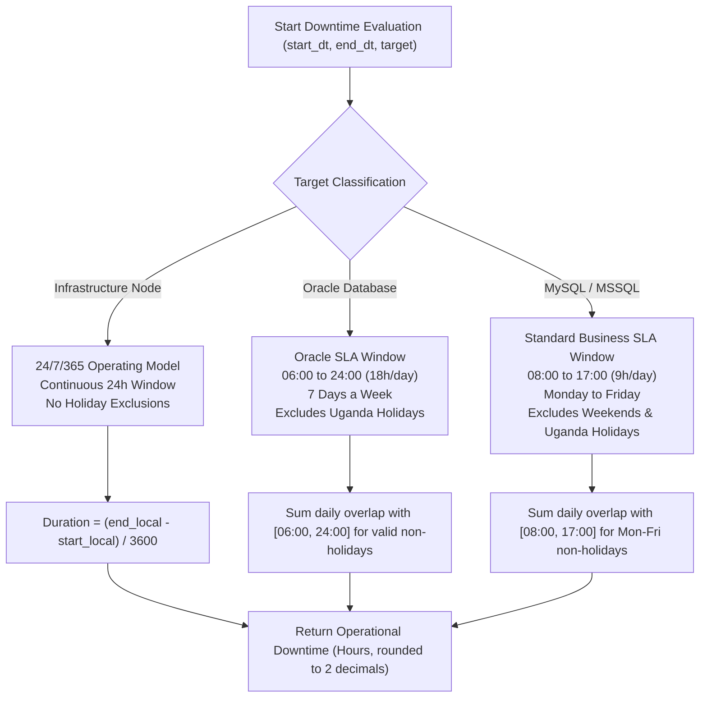
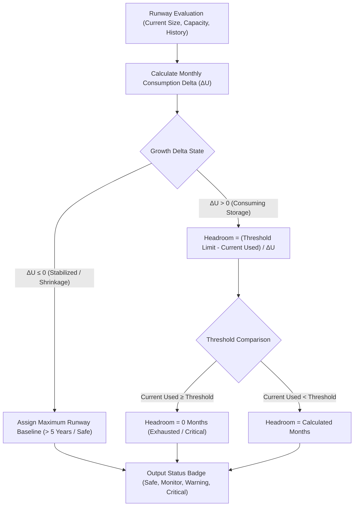

# DBTRAC: Database & Infrastructure Tracking for Reliability, Administration and Compliance
## SYSTEM DESIGN DOCUMENT (SDD)

**Document Version:** 2.0  
**Effective Date:** 22 October 2026  
**Status:** Approved Technical Architecture Baseline  
**Prepared By:** DBA Ashley Atim  
**Reviewed By:** Senior Database Administrator (SDBA)  
**Approved By:** Chief Information and Communications Technology Officer (CICTO)  
**Organization:** National Medical Stores (NMS), Medical Logistics Directorate  

---

## Sign-Off and Approvals

| Role | Name | Designation | Signature / Status |
| :--- | :--- | :--- | :--- |
| **Prepared By** | Ashley Atim | Database Administrator (DBA) | Signed / Approved |
| **Reviewed By** | SDBA Team Lead | Senior Database Administrator | Signed / Approved |
| **Approved By** | CICTO | Chief ICT Officer | Signed / Approved |

---

## Glossary of Terms

1. **WSGI (Web Server Gateway Interface):** The standardized Python specification enabling communication between web servers (such as Nginx via Gunicorn) and Python application frameworks (such as Django).
2. **Gunicorn ("Green Unicorn"):** A high-performance, pre-fork worker WSGI HTTP server executing the DBTRAC Django application processes in production Linux environments.
3. **Nginx:** An asynchronous, high-throughput reverse proxy and web server terminating HTTP/HTTPS, serving compiled static assets, and proxying application traffic to Gunicorn on port 8080/90.
4. **ETL (Extract, Transform, Load) Pipeline:** The network of automated collectors, host scripts, and Prometheus query bridges gathering operating metrics, transforming them to structured payloads, and posting them to authenticated ingestion endpoints.
5. **Node Exporter:** Prometheus metric instrumentation agent deployed across host hypervisors exposing hardware and OS metrics on port 9100.
6. **OLKVM (Oracle Linux KVM):** The hypervisor cluster hosting the enterprise Oracle Database (`nmsinfra.nms.go.ug`) and Oracle E-Business Suite Application Tier (`nmsebs.nms.go.ug`).
7. **Proxmox VE:** The enterprise virtualization cluster (`pvenode1`, `pvenode2`, `pvenode3`) hosting internal web servers, monitoring instances, and satellite database servers.
8. **Storage Runway & Headroom Engine:** Mathematical forecasting algorithm that calculates remaining storage runway before reaching configured warning thresholds (80% / 90%) using historical baseline deltas, consumption trends, and negative-growth drift dampeners.
9. **Smart Save & Operational Duration Engine:** Core business logic in `IncidentRegister` and `sla_utils.py` calculating downtime strictly within defined SLA operating windows (e.g. 18h/day, 7 days/week for Oracle; 9h/day, 5 days/week for MySQL; 24/7 continuous for Infrastructure), excluding national statutory holidays.
10. **Incident Staging Buffer:** Decoupled review buffer isolating automated telemetry alerts and ping failures from production SLA registers, requiring explicit DBA/SysAdmin review, intermittent outage triage (< 15 min), and promotion.
11. **Uganda Statutory Holiday Registry:** Central calendar engine (`UgandaHoliday`) maintaining fixed national public holidays and moveable religious holidays to prevent erroneous SLA downtime penalization.
12. **Immutable Audit Trail:** Append-only ledger (`IncidentChangeLog`) recording user identity, state transitions, assignee reallocations, and mandatory justification comments.

---

## Table of Contents

1. [Introduction](#1-introduction)
   - 1.1 [Purpose](#11-purpose)
   - 1.2 [Scope](#12-scope)
   - 1.3 [System Overview](#13-system-overview)
2. [System Architecture](#2-system-architecture)
   - 2.1 [Architectural Topology](#21-architectural-topology)
   - 2.2 [Logical Tier Architecture](#22-logical-tier-architecture)
   - 2.3 [Target Scope Separation (Database vs. Infrastructure)](#23-target-scope-separation-database-vs-infrastructure)
3. [Deployment Architecture](#3-deployment-architecture)
   - 3.1 [Web Server Layer (Nginx)](#31-web-server-layer-nginx)
   - 3.2 [Application Server Layer (Gunicorn WSGI)](#32-application-server-layer-gunicorn-wsgi)
   - 3.3 [Application Framework Layer (Django 5.x)](#33-application-framework-layer-django-5x)
   - 3.4 [Persistence Layer (MySQL 8.x)](#34-persistence-layer-mysql-8x)
4. [Database Design & Relational Schema](#4-database-design--relational-schema)
   - 4.1 [Relational Model Overview](#41-relational-model-overview)
   - 4.2 [Entity Relationship Matrix](#42-entity-relationship-matrix)
5. [Core Operational Data Models](#5-core-operational-data-models)
   - 5.1 [Incident Register (`IncidentRegister`)](#51-incident-register-incidentregister)
   - 5.2 [Incident Audit Trail (`IncidentChangeLog`)](#52-incident-audit-trail-incidentchangelog)
   - 5.3 [Incident Staging Buffer (`IncidentStaging`)](#53-incident-staging-buffer-incidentstaging)
   - 5.4 [Maintenance Register (`MaintenanceRegister`)](#54-maintenance-register-maintenanceregister)
   - 5.5 [Backup & Recovery Registry (`BackupRecovery`)](#55-backup--recovery-registry-backuprecovery)
   - 5.6 [Replication Monitor (`ReplicationMonitor`)](#56-replication-monitor-replicationmonitor)
   - 5.7 [Server Health & Telemetry (`ServerHealth`)](#57-server-health--telemetry-serverhealth)
   - 5.8 [Capacity Planning (`CapacityPlanning`)](#58-capacity-planning-capacityplanning)
   - 5.9 [SLA Configuration (`SLAConfig`) & Uganda Holidays (`UgandaHoliday`)](#59-sla-configuration-slaconfig--uganda-holidays-ugandaholiday)
6. [Monitoring Agent & Ingestion Architecture](#6-monitoring-agent--ingestion-architecture)
   - 6.1 [Agent Topology](#61-agent-topology)
   - 6.2 [Prometheus Node Exporter Integration](#62-prometheus-node-exporter-integration)
   - 6.3 [API Ingestion Security & Authentication](#63-api-ingestion-security--authentication)
   - 6.4 [Ingestion Endpoints Specification](#64-ingestion-endpoints-specification)
7. [Alert Review & Staging Triage Engine](#7-alert-review--staging-triage-engine)
   - 7.1 [Staging Queue Architecture](#71-staging-queue-architecture)
   - 7.2 [Intermittent Network Outage Detection (< 15 Minutes)](#72-intermittent-network-outage-detection--15-minutes)
   - 7.3 [Promotion & Reclassification Workflows](#73-promotion--reclassification-workflows)
8. [Business Logic & Mathematical Engines](#8-business-logic--mathematical-engines)
   - 8.1 [SLA Availability Engine](#81-sla-availability-engine)
   - 8.2 [Downtime Operating Window Calculation Logic](#82-downtime-operating-window-calculation-logic)
   - 8.3 [KPI Engine (MTTR, Success Rates, Breaches)](#83-kpi-engine-mttr-success-rates-breaches)
   - 8.4 [Replication Health State Engine](#84-replication-health-state-engine)
   - 8.5 [Storage Runway & Headroom Forecasting Engine](#85-storage-runway--headroom-forecasting-engine)
9. [Monitoring Dashboards & User Interfaces](#9-monitoring-dashboards--user-interfaces)
   - 9.1 [Database Operations Executive Dashboard](#91-database-operations-executive-dashboard)
   - 9.2 [Infrastructure & Virtualization Dashboard](#92-infrastructure--virtualization-dashboard)
   - 9.3 [Capacity Planning & Storage Analytics](#93-capacity-planning--storage-analytics)
   - 9.4 [UI Standardization & Performance Controls](#94-ui-standardization--performance-controls)
10. [Security, Governance & Access Control](#10-security-governance--access-control)
    - 10.1 [Role-Based Access Control (RBAC)](#101-role-based-access-control-rbac)
    - 10.2 [Five-Minute Creator Self-Correction Window](#102-five-minute-creator-self-correction-window)
    - 10.3 [Administrator Override & Audit Safeguards](#103-administrator-override--audit-safeguards)
    - 10.4 [Session Governance & Password Policies](#104-session-governance--password-policies)
11. [Reporting & Executive Export Engine](#11-reporting--executive-export-engine)
    - 11.1 [Automated Multi-Tab Excel Generation (OpenPyXL)](#111-automated-multi-tab-excel-generation-openpyxl)
    - 11.2 [Executive Print-Ready Layouts](#112-executive-print-ready-layouts)
12. [Environment, Infrastructure & Technology Stack](#12-environment-infrastructure--technology-stack)
13. [Traceability Matrix (Requirements to Design)](#13-traceability-matrix-requirements-to-design)
14. [Deployment, Maintenance & Operational Runbook](#14-deployment-maintenance--operational-runbook)
15. [Architectural Conclusion](#15-architectural-conclusion)

---

## 1. Introduction

### 1.1 Purpose
This System Design Document (SDD) establishes the definitive technical architecture, data models, business logic equations, ingestion pipelines, and operational controls for the **DBTRAC (Database Tracking for Reliability, Administration and Compliance)** platform. It supersedes Version 1.0 (June 2026) to incorporate the unified **Infrastructure & Virtualization Fleet Monitoring**, **Prometheus Node Telemetry**, **Automated Storage Runway & Headroom Intelligence**, **Incident Staging Buffer**, and **Uganda Public Holiday SLA Exclusion Engine**.

### 1.2 Scope
DBTRAC governs operational reliability, compliance, capacity planning, and SLA tracking across all enterprise database engines and host hypervisors supporting National Medical Stores (NMS):
* **Monitored Database Engines:** Oracle Database 19c Enterprise/Standard, MySQL 8.x, Microsoft SQL Server 2016+.
* **Monitored Infrastructure Hosts:** Oracle Linux KVM (OLKVM) Cluster (`nmsinfra`, `nmsebs`) and Proxmox VE Virtualization Fleet (`pvenode1`, `pvenode2`, `pvenode3`).
* **Operational Capabilities:** Automated telemetry ingestion, human-in-the-loop alert triage, SLA and KPI calculations, predictive storage forecasting, automated audit trails, and executive reporting.

### 1.3 System Overview
DBTRAC functions as a centralized, high-availability operations hub providing a single pane of glass for DBAs, System Administrators, and IT Leadership. It bridges raw machine-level telemetry (Prometheus, scheduled crons, SQL ping probes) with executive governance, transforming operational data into auditable metrics, SLA compliance ratings, and multi-tier capacity runways.

---

## 2. System Architecture

### 2.1 Architectural Topology
DBTRAC utilizes a decoupled, multi-tiered architecture that separates telemetry collection from operational calculation, persistence, and presentation.



### 2.2 Logical Tier Architecture
1. **Tier 1 (Telemetry):** Distributed agents running directly on hypervisors and database hosts collecting raw metrics.
2. **Tier 2 (Collection):** Central Prometheus server polling Node Exporters across the enterprise LAN.
3. **Tier 3 (Ingestion):** Authenticated endpoints terminating incoming telemetry and decoupling external scripts from core tables.
4. **Tier 4 (Business Logic):** Pure Python calculation engines evaluating SLA windows, MTTR, storage regressions, and public holiday offsets.
5. **Tier 5 (Persistence):** Relational MySQL store enforcing referential integrity, unique constraints, and transaction isolation.
6. **Tier 6 (Presentation & Audit):** Clean, tab-separated Django templates providing role-segregated operational control and exportability.

### 2.3 Target Scope Separation (Database vs. Infrastructure)
A core tenet of DBTRAC v2.0 is the **strict architectural isolation** between Database platforms and Infrastructure host nodes:

| Parameter | Database Target Layer | Infrastructure Target Layer |
| :--- | :--- | :--- |
| **Monitored Scope** | Oracle Database, MySQL, MS SQL Server | OLKVM Host, Proxmox Cluster (`pvenode1`, `pvenode2`, `pvenode3`) |
| **Operating Window** | **Oracle:** 06:00 – 24:00 (18h/d, 7d/w)<br>**MySQL/MSSQL:** 08:00 – 17:00 (9h/d, Mon–Fri) | **Continuous 24/7/365:** 24h/d, 7d/w, no holiday exclusions |
| **Holiday Exclusions** | Excluded via `UgandaHoliday` registry | Never excluded (Hypervisors run continuously) |
| **Ticket Notation** | Standard: `INC-YYMMDD-HHMM` | Infrastructure: `INC-INFRA-YYMMDD-HHMM` |
| **SLA Baseline Target** | Oracle / MSSQL: $\ge 99.95\%$; MySQL: $\ge 99.50\%$ | Host Hypervisor Fleet: $\ge 99.90\%$ |
| **Primary Personnel** | Database Administrators (DBA) | System Administrators (SysAdmin) |

---

## 3. Deployment Architecture

### 3.1 Web Server Layer (Nginx)
Nginx functions as the perimeter reverse proxy and edge router:
* **Ports Monitored:** Port 80 (Standard HTTP) and Port 90 (Corporate Internal Network Proxy).
* **Static Assets:** Serves pre-compiled CSS, JavaScript, and corporate branding assets directly from `/opt/Uptime_tracker/backend/staticfiles/` using kernel-level `sendfile`.
* **Request Buffering:** Buffers slow client connections, proxying validated HTTP requests over Unix sockets or localhost (`127.0.0.1:8080`) to Gunicorn.
* **Security Headers:** Enforces `X-Content-Type-Options: nosniff`, `X-Frame-Options: SAMEORIGIN`, and strict CSRF referrer verification across trusted corporate hosts.

### 3.2 Application Server Layer (Gunicorn WSGI)
* **Process Model:** Pre-fork worker architecture running under Python 3.11+.
* **Process Pool:** 4 worker processes with 2 threads per worker, configured with automatic worker recycling (`--max-requests 1000 --max-requests-jitter 50`) to prevent memory fragmentation.
* **Service Supervision:** Managed under `systemd` via `uptime_tracker.service` with graceful reload support (`pkill -HUP -f gunicorn`).

### 3.3 Application Framework Layer (Django 5.x)
* **Architecture:** Model-View-Template (MVT) architecture with strict separation between views, forms, business logic utilities, and serializers.
* **Template Rendering:** Server-side template rendering with custom template tags for human-readable durations, badge classifications, and dynamic SVG charts.
* **Session Governance:** Session expiration configured at 1,200 seconds (20 minutes of inactivity) with browser-close expiration.

### 3.4 Persistence Layer (MySQL 8.x)
* **Storage Engine:** InnoDB supporting ACID transactions, row-level locking, and foreign key integrity.
* **Connection Pooling:** `CONN_MAX_AGE = 60` to recycle persistent connections and minimize SSL/TCP handshake overheads.
* **Character Set:** `utf8mb4` with `utf8mb4_unicode_ci` collation supporting international text and structured logs.

---

## 4. Database Design & Relational Schema

### 4.1 Relational Model Overview
The relational architecture organizes operational state across dedicated entities:



---

## 5. Core Operational Data Models

### 5.1 Incident Register (`IncidentRegister`)
The primary model for operational downtime records:
* **Scope Classification:** `category` (`Database` vs `Infrastructure`) dynamically controls UI form presentation, required fields, and calculation routing.
* **Smart Ticket Auto-Generation:** Uses `generate_incident_ticket(category, dt)` producing sequential, collision-free codes:
  * Database: `INC-YYMMDD-HHMM` (e.g., `INC-261022-0930`)
  * Infrastructure: `INC-INFRA-YYMMDD-HHMM` (e.g., `INC-INFRA-261022-0930`)
* **Smart Start & Resolution Timestamps:**
  * If `start` is null on creation, it defaults to `timezone.now()`.
  * If `status` transitions to `Resolved` or `Closed` and `end` is null, `end` automatically records `timezone.now()`.
* **Dynamic Operating Duration:** Overrides standard wall-clock math by routing through `calculate_operational_downtime()` to reflect true business hours.

### 5.2 Incident Audit Trail (`IncidentChangeLog`)
* **Immutable Append-Only Design:** Captures all changes to `status`, `assigned_to`, and operational notes.
* **Mandatory Change Comments:** Form validation requires a non-empty `change_comment` whenever an incident's status or assignee is altered.
* **Audit Fields:** Timestamp (`changed_at`), modifying user (`changed_by`), before/after state transitions (`old_status`, `new_status`), and recorded DBA justification.

### 5.3 Incident Staging Buffer (`IncidentStaging`)
* **Buffer Mechanism:** Absorbs automated pings and threshold triggers without polluting production SLA registers.
* **Status Lifecycle:** `Awaiting Review` $\rightarrow$ `Promoted to Incident` | `Promoted to Maintenance` | `Dismissed`.
* **Intermittent Outage Tagging:** Automatically identifies events with duration $< 15\text{ minutes}$ as potential network blips.

### 5.4 Maintenance Register (`MaintenanceRegister`)
* **Planned Downtime Governance:** Captures approved RFC change windows (`change_id`).
* **SLA Isolation:** All records in `MaintenanceRegister` with `success=True` are strictly excluded from unplanned downtime calculations.
* **Auto-Status Transitions:** Background evaluator transitions maintenance windows:
  * `Scheduled` $\rightarrow$ `In Progress` when $\text{start} \le \text{now} < \text{end}$.
  * `In Progress` $\rightarrow$ `Completed` when $\text{now} \ge \text{end}$.

### 5.5 Backup & Recovery Registry (`BackupRecovery`)
* **Unified Dual-Type Entity:** Segregates scheduled operational backups from disaster recovery restore drills via `record_type`:
  * `Backup`: Evaluates backup compliance against the daily 24-hour SLA window.
  * `Recovery`: Tracks non-production DR restore drills, recovery duration, and data integrity verification.

### 5.6 Replication Monitor (`ReplicationMonitor`)
* **Engine Scope:** Tracks binary log replication threads for MySQL (`nickledbnew` $\rightarrow$ `nickledbdr`) and Oracle Data Guard streams.
* **Health Parameters:** IO Thread state (`Yes`/`No`), SQL Thread state (`Yes`/`No`), and Seconds Behind Master (`lag_seconds`).

### 5.7 Server Health & Telemetry (`ServerHealth`)
* **Host Resource Profiling:** Captures daily utilization profiles for CPU, memory, and filesystem mounts.
* **Provenance Tagging:** Distinguishes records entered manually from automated telemetry (`entered_by='Prometheus'`).

### 5.8 Capacity Planning (`CapacityPlanning`)
* **Storage Metrics:** Captures total capacity, allocated storage, active database size, net monthly growth, and calculated runway.
* **Redesign Attributes:** Stores calculated headroom months and daily consumption deltas.

### 5.9 SLA Configuration (`SLAConfig`) & Uganda Holidays (`UgandaHoliday`)
* **SLA Target Hours:** Stores baseline operational hours and contract percentage targets per database/month.
* **Holiday Calendar:** Stores official Uganda statutory public holidays to automatically exclude non-working days from SLA calculations.

---

## 6. Monitoring Agent & Ingestion Architecture

### 6.1 Agent Topology
Monitoring agents are decoupled from the DBTRAC core application. Telemetry gathering occurs via two primary pipelines:
1. **Push Telemetry (REST Clients):** Local cron scripts and database jobs connecting to Oracle, MySQL, and SQL Server execute lightweight diagnostic queries and POST JSON payloads to DBTRAC.
2. **Pull Telemetry (Prometheus Scraper):** DBTRAC's ETL service queries the centralized Prometheus server over HTTP PromQL to ingest host hypervisor metrics.

### 6.2 Prometheus Node Exporter Integration
Prometheus scrapes Node Exporters across hypervisors on port 9100. DBTRAC ingests these metrics via `sync_prometheus_metrics()`:



#### Monitored Node Exporter Metrics:
* **Reachability:** `up{instance="<host>:9100"}`
* **CPU Utilization:** `100 - (avg by (instance) (rate(node_cpu_seconds_total{mode="idle"}[5m])) * 100)`
* **Memory Utilization:** `(1 - (node_memory_MemAvailable_bytes / node_memory_MemTotal_bytes)) * 100`
* **Storage Filesystem:** `node_filesystem_free_bytes` and `node_filesystem_size_bytes` filtered by mountpoints:
  * OLKVM: `/u01` (Oracle Data), `/nmsddbkp` (Data Domain Backup), `/` (Root), `/stagearea`
  * Proxmox: `/`, `local-lvm`, `VMSAN`

### 6.3 API Ingestion Security & Authentication
* **Header-Based Authentication:** Automated clients must pass an API token via the `X-API-KEY` HTTP header.
* **Token Validation:** Ingestion views validate the received key against `REPLICATION_API_KEY` configured in the server environment.
* **Rejection:** Unauthorized or unauthenticated requests are rejected with `HTTP 401 Unauthorized` or `HTTP 403 Forbidden`.

### 6.4 Ingestion Endpoints Specification

| Endpoint | Method | Payload Scope | Target Entity |
| :--- | :--- | :--- | :--- |
| `/api/staging/ingest/` | `POST` | Raw ping failures, node unreachable alerts | `IncidentStaging` |
| `/api/health/ingest/` | `POST` | Host CPU, RAM, Disk utilization | `ServerHealth` |
| `/api/backup/ingest/` | `POST` | Backup execution outcome, start/end timestamps | `BackupRecovery` |
| `/api/replication/ingest/` | `POST` | IO/SQL thread status, replication delay seconds | `ReplicationMonitor` |
| `/api/capacity/ingest/` | `POST` | Tablespace, database, and filesystem allocations | `CapacityPlanning` |

---

## 7. Alert Review & Staging Triage Engine

### 7.1 Staging Queue Architecture
To prevent false-positive telemetry alerts (such as brief network jitter or transient probe timeouts) from corrupting executive SLA reports, all automated outage detections are held in `IncidentStaging`.



### 7.2 Intermittent Network Outage Detection (< 15 Minutes)
During automated ingestion, DBTRAC evaluates the calculated duration of the event:
$$\Delta t = \text{End Timestamp} - \text{Start Timestamp}$$
If $\Delta t < 0.25\text{ hours}$ (15 minutes), DBTRAC prefixes the root cause description:
```text
[POTENTIAL NETWORK INTERMITTENCE (< 15m)] Automated probe failed to contact host; recovered within 15 minutes.
```
This alert classification provides DBAs with immediate visual context, preventing premature escalations for self-healing network blips.

### 7.3 Promotion & Reclassification Workflows
1. **Promote to Incident:** Converts the staged record into a formal `IncidentRegister` record. The user selects the severity, confirms the root cause, and assigns the ticket. If unplanned, it immediately impacts the reporting month's SLA.
2. **Promote to Maintenance:** If the alert coincided with an authorized RFC window, the record is promoted to `MaintenanceRegister`. This preserves operational history while excluding the downtime from SLA penalties.
3. **Dismiss (False Positive):** If verified as a transient network flap, the record is removed from the active staging queue with user confirmation.

---

## 8. Business Logic & Mathematical Engines

### 8.1 SLA Availability Engine
The SLA Availability Engine computes monthly operational availability per target platform:

$$\text{Availability } (\%) = \left( \frac{\text{Target SLA Hours} - \text{Unplanned Downtime Hours}}{\text{Target SLA Hours}} \right) \times 100$$

Where:
* **$\text{Target SLA Hours}$ ($T_h$):** Calculated dynamically from the monthly calendar by summing operational hours across all valid business days, excluding registered national public holidays.
* **$\text{Unplanned Downtime Hours}$ ($D_u$):** The sum of operational downtime for all incidents where `planned = False` occurring within the reporting month.

### 8.2 Downtime Operating Window Calculation Logic
Downtime is calculated strictly within defined SLA operational windows via `api.sla_utils.calculate_operational_downtime()`:



#### Detailed SLA Window Rules:
1. **Oracle Database Tier (`nmsinfra`, `nmsebs`):**
   * **Active Window:** 06:00:00 to 24:00:00 (18 operational hours per day).
   * **Days Covered:** Monday through Sunday (7 days per week).
   * **Exclusions:** Official Uganda Statutory Public Holidays (Christmas, Independence Day, etc.). Outages occurring outside 06:00–24:00 or on statutory holidays incur **0.00** SLA penalty.
2. **Non-Oracle Database Tier (MySQL, MS SQL Server):**
   * **Active Window:** 08:00:00 to 17:00:00 (9 operational hours per day).
   * **Days Covered:** Monday through Friday (5 business days per week).
   * **Exclusions:** Weekends (Saturday, Sunday) and Uganda Statutory Public Holidays.
3. **Infrastructure Host Tier (OLKVM, Proxmox VE Nodes):**
   * **Active Window:** Continuous 24 hours per day, 7 days per week (24/7/365).
   * **Exclusions:** None. Virtualization hypervisors must maintain uninterrupted uptime.

### 8.3 KPI Engine (MTTR, Success Rates, Breaches)
* **Mean Time to Repair (MTTR):**
  $$\text{MTTR (Minutes)} = \left( \frac{\sum D_u}{\text{Total Unplanned Incidents}} \right) \times 60$$
* **Backup Success Rate:**
  $$\text{Backup Success Rate } (\%) = \left( \frac{\text{Successful Backups}}{\text{Total Scheduled Backups}} \right) \times 100$$
* **DR Restore Success Rate:**
  $$\text{DR Success Rate } (\%) = \left( \frac{\text{Successful DR Restore Drills}}{\text{Total Conducted DR Drills}} \right) \times 100$$
* **SLA Resolution Target Breaches:** Based on corporate IT Service Desk Policy §20.4.5.2:
  * **Critical:** 9 hours (1 business day)
  * **High:** 9 hours (1 business day)
  * **Medium:** 18 hours (2 business days)
  * **Low:** 180 hours (4 weeks)

### 8.4 Replication Health State Engine
Replication state is marked **Healthy** if and only if:
$$\text{IO Thread} = \text{'Yes'} \quad \land \quad \text{SQL Thread} = \text{'Yes'} \quad \land \quad \text{Replication Lag} \le 120\text{ seconds}$$
If either thread is stopped or lag exceeds 120 seconds, the state transitions to **Degraded** or **Critical**.

### 8.5 Storage Runway & Headroom Forecasting Engine
DBTRAC utilizes an intelligent linear growth forecasting model that predicts the date and remaining months before a filesystem or tablespace exhausts its configured safety threshold (80% or 90% capacity).



#### Mathematical Formulation:
Let:
* $C$ = Total Disk / Filesystem Capacity (GB)
* $U_{current}$ = Current Used Storage (GB)
* $T_{limit} = C \times \text{Threshold Pct}$ (e.g. $C \times 0.80$ for an 80% ceiling)
* $\Delta U_{monthly}$ = Average Monthly Storage Growth (GB/month)

1. **Active Storage Growth ($\Delta U_{monthly} > 0$):**
   $$\text{Headroom (Months)} = \frac{T_{limit} - U_{current}}{\Delta U_{monthly}}$$
2. **Safety Threshold Breach ($U_{current} \ge T_{limit}$):**
   $$\text{Headroom} = 0.0\text{ Months (Action Required)}$$
3. **Stabilized or Negative Growth ($\Delta U_{monthly} \le 0$):**
   When disk cleanup, table purges, or archiving causes usage to decrease or stabilize, the algorithm prevents division-by-zero or negative runway errors by classifying the tier as **Safe / Indefinite Runway** ($> 5\text{ Years}$), provided available capacity remains above safety margins.

---

## 9. Monitoring Dashboards & User Interfaces

### 9.1 Database Operations Executive Dashboard
* **Primary Route:** `/`
* **Features:** Comprehensive executive KPI summaries, SLA status cards for Oracle, MySQL, and MS SQL Server, backup reliability indicators, replication health badges, and trend sparklines.
* **Filter Controls:** Month-by-month historical selector enabling audits of previous fiscal periods.

### 9.2 Infrastructure & Virtualization Dashboard
* **Primary Route:** `/incidents/?tab=infrastructure` and `/capacity/?tab=infrastructure`
* **Features:** Dedicated visibility into OLKVM and Proxmox hypervisor nodes. Displays live CPU and memory utilization gauges, mountpoint storage consumption, and active infrastructure incidents.
* **Node Filter:** Instant selector for `All Nodes`, `nmsinfra`, `nmsebs`, `pvenode1`, `pvenode2`, or `pvenode3`.

### 9.3 Capacity Planning & Storage Analytics
* **Primary Route:** `/capacity/`
* **Features:** Storage runway cards, growth forecasting charts, filesystem utilization progress bars, and fleet-wide capacity summaries.
* **Pagination:** Node Capacity table paginated at 10 records per page to prevent page bloat.

### 9.4 UI Standardization & Performance Controls
* **Typography & Styling:** Minimalist, high-legibility enterprise aesthetic. Replaced cluttering rounded badges with crisp, professional typographic labels.
* **Clean Forms:** Standardized forms with prominent red validation error alerts, inline field error highlighting, and smart fallbacks.

---

## 10. Security, Governance & Access Control

### 10.1 Role-Based Access Control (RBAC)
DBTRAC enforces fine-grained authorization across distinct user groups:
* **Database Administrator (DBA):** Full management of Database Incidents, Maintenance, Backups, Replication, and Capacity Planning.
* **System Administrator (SysAdmin):** Management of Infrastructure Incidents, Node Capacity, and Prometheus telemetry reviews.
* **Executive / Auditor:** Read-only access to Dashboards, Analytics, and Excel/Print report generators.

### 10.2 Five-Minute Creator Self-Correction Window
To safeguard data integrity while accommodating human error during manual incident logging:
* Standard users who create an incident may edit or correct their record **strictly within 300 seconds (5 minutes)** of creation:
  $$\Delta t_{edit} = \text{Current Time} - \text{Record Creation Time} \le 300\text{ seconds}$$
* Once the 5-minute window expires, edit and delete controls are automatically hidden and forbidden at the view layer.

### 10.3 Administrator Override & Audit Safeguards
* **Admin Privilege:** Superusers and users with `is_admin = True` bypass the 5-minute window to execute administrative corrections.
* **Audit Mandate:** Any post-window administrative modification mandates a written justification comment logged permanently to `IncidentChangeLog`.
* **Automated Record Protection:** Records created via automated ingestion (`created_by__isnull=True`) cannot be deleted by automated routines on list page loads.

### 10.4 Session Governance & Password Policies
* **Session Timeout:** Inactivity timeout enforced at 20 minutes (`SESSION_COOKIE_AGE = 1200`).
* **Password Validation:** Enforces `CorporationPasswordValidator` requiring minimum 8 characters, uppercase, lowercase, numeric, and special character complexity.
* **First-Login Enforcement:** `PasswordChangeRequiredMiddleware` intercepts authenticated users flagged with `must_change_password=True`, redirecting them to change credentials before accessing operational registers.

---

## 11. Reporting & Executive Export Engine

### 11.1 Automated Multi-Tab Excel Generation (OpenPyXL)
DBTRAC generates executive-ready Excel reports formatted to corporate presentation standards:
* **Route:** `/dashboard/excel/?month=YYYY-MM`
* **Workbook Structure:**
  * **Tab 1 ("Executive SLA Summary"):** Target hours, downtime breakdowns, availability percentages, MTTR, and SLA ratings.
  * **Tab 2 ("Unplanned Incidents"):** Detailed incident register including root cause and duration.
  * **Tab 3 ("Planned Maintenance"):** RFC maintenance windows and outcomes.
  * **Tab 4 ("Backup & DR Assurance"):** Backup execution records and DR restore drill results.
  * **Tab 5 ("Capacity & Storage Runway"):** Storage runway projections and monthly growth trends.

### 11.2 Executive Print-Ready Layouts
* **Route:** `/dashboard/print/?month=YYYY-MM`
* **Features:** Clean CSS `@media print` stylesheets stripping navigation sidebars, headers, and buttons, rendering high-contrast, print-optimized executive briefs.

---

## 12. Environment, Infrastructure & Technology Stack

| Component | Technical Specification | Role / Configuration |
| :--- | :--- | :--- |
| **Operating System** | Rocky Linux 9 / Ubuntu 22.04 LTS / Windows Server 2019+ | Host Server Environment |
| **Python Runtime** | Python 3.11+ | Application Language Runtime |
| **Web Framework** | Django 5.x / 6.x | Core Web & Business Logic Framework |
| **WSGI Server** | Gunicorn 21.x+ | Production Pre-Fork WSGI HTTP Server |
| **Web Server / Proxy** | Nginx 1.22+ | Reverse Proxy, SSL Termination, Port 80/90 Edge |
| **Application Database**| MySQL Enterprise 8.0+ | Relational Persistent Data Store (InnoDB) |
| **Metrics Collector** | Prometheus Server 2.45+ | Node Exporter Time Series Scraper (:9090) |
| **Host Metrics Agent** | Prometheus Node Exporter 1.6+ | Host Hypervisor Hardware Instrumentation (:9100) |
| **Excel Engine** | OpenPyXL 3.1+ | Multi-Tab Automated Workbook Generation |

---

## 13. Traceability Matrix (Requirements to Design)

| System Requirement | Design Component | Technical Implementation |
| :--- | :--- | :--- |
| **SRD-01: SLA Tracking** | SLA Availability Engine | `views._get_dashboard_data`, `sla_utils.calculate_operational_downtime` |
| **SRD-02: Oracle 18h Window** | SLA Business Window Logic | `sla_utils.calculate_operational_downtime` (06:00–24:00 daily filter) |
| **SRD-03: Statutory Holidays** | Uganda Holiday Registry | `api.models.UgandaHoliday`, `views.autopopulate_fixed_holidays` |
| **SRD-04: Infrastructure Tracking**| Hypervisor Fleet Engine | `category='Infrastructure'`, 24/7 operating model, OLKVM/Proxmox tabs |
| **SRD-05: Telemetry Scraper** | Prometheus ETL Integration | `etl.services.rest_client.sync_all_nodes_from_prometheus` |
| **SRD-06: Storage Runway** | Capacity Runway Engine | `views._calculate_runway`, `CapacityPlanning` model |
| **SRD-07: Alert Triage** | Incident Staging Buffer | `IncidentStaging`, `views.incident_staging_list`, `< 15m` blip filter |
| **SRD-08: Auditability** | Immutable Change Log | `IncidentChangeLog`, forced comment validation on state change |
| **SRD-09: Self-Correction Window**| 5-Minute Modification Rule | `views.incident_edit` (`timezone.now() - created_at < 300`) |
| **SRD-10: Executive Reporting** | OpenPyXL Export Pipeline | `views.dashboard_excel`, `views.dashboard_print` |

---

## 14. Deployment, Maintenance & Operational Runbook

### 14.1 Production Service Management
DBTRAC runs as a managed `systemd` service on host `nms360`:
```bash
# Verify active application daemon status
sudo systemctl status uptime_tracker

# Graceful code reload after pulling git updates (Zero-Downtime)
sudo pkill -HUP -f gunicorn

# Full service restart if configuration or virtualenv dependencies change
sudo systemctl restart uptime_tracker

# Check real-time application logs
sudo journalctl -u uptime_tracker -f
```

### 14.2 Code Deployment Procedure
```bash
# Navigate to production root
cd /opt/Uptime_tracker

# Pull latest commits from GitHub origin/main
git pull origin main

# Collect any new static assets
python manage.py collectstatic --noinput

# Apply database schema migrations if models changed
python manage.py migrate

# Reload Gunicorn worker processes
sudo pkill -HUP -f gunicorn
```

### 14.3 Prometheus Background Sync Execution
Prometheus metrics sync can be triggered manually or via cron:
```bash
# Execute standalone Prometheus sync command
python manage.py sync_prometheus
```

---

## 15. Architectural Conclusion

DBTRAC Version 2.0 represents a comprehensive evolution from a standalone database tracker to an enterprise-grade **Database and Infrastructure Reliability Platform**. By unifying database engines with host virtualization hypervisors, establishing strict SLA business-hour calculation rules, decoupling automated telemetry through an audited staging buffer, and delivering predictive storage runways, DBTRAC guarantees transparency, auditable compliance, and operational excellence across National Medical Stores' mission-critical healthcare systems.

---
*End of DBTRAC System Design Document v2.0*
