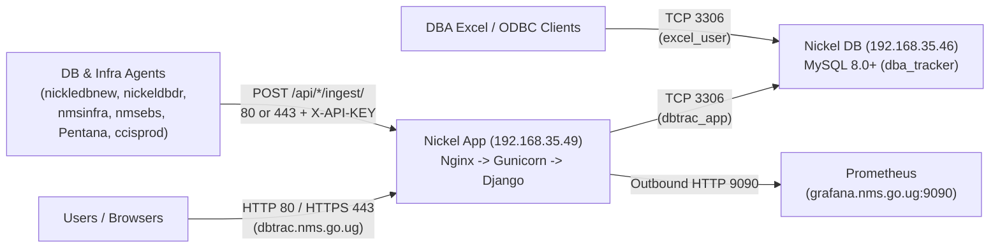

# DBTRAC v2.0 Production Deployment & Migration Guide

**Target Production Topology:**
- **Application Server (`Nickel App`):** `192.168.35.49` (Nginx + Gunicorn + Django `6.0.7` + Cron)
- **Database Server (`Nickel DB`):** `192.168.35.46` (MySQL `8.0+`, Database `dba_tracker`)
- **Production Domain:** `dbtrac.nms.go.ug` (HTTP `80` / HTTPS `443`)
- **Legacy / Current Source (`nms360`):** `192.168.35.38` (`/opt/Uptime_tracker`, Port `90`, DB `dba_tracker`) — **leave untouched until Cutover Window (Phase 7)**

> [!IMPORTANT]
> **Branch Status Before Deploying:**
> Production v2 changes (Infrastructure & Prometheus telemetry, CCIS PostgreSQL 17 support, SRD SLA governance fixes, UI/PDF reports, and updated Prod-only fallback URLs) live on `feature/infrastructure-prometheus`, while `main` is still on frozen v1 (`3a441e0`).
> Before pulling onto `Nickel App`, either merge `feature/infrastructure-prometheus` into `main` on GitHub, or deploy `feature/infrastructure-prometheus` directly.

---

## Architecture & Firewall Matrix



### Required Firewall Rules

| Source | Destination | Port / Protocol | Purpose |
|---|---|---|---|
| Workstation LAN / VPN | `192.168.35.49` (`Nickel App`) | `80/tcp`, `443/tcp` | Web UI & REST ingestion (`dbtrac.nms.go.ug`) |
| Monitored DB & Infra Hosts | `192.168.35.49` (`Nickel App`) | `80/tcp`, `443/tcp` | Collector agents (`/api/*/ingest/`) |
| `192.168.35.49` (`Nickel App`) | `192.168.35.46` (`Nickel DB`) | `3306/tcp` | Django MySQL connection |
| `192.168.35.49` (`Nickel App`) | `grafana.nms.go.ug` | `9090/tcp` | Prometheus node telemetry queries |
| Authorized Excel / Admin Hosts | `192.168.35.46` (`Nickel DB`) | `3306/tcp` | Excel ODBC views (`excel_user`) & DBA maintenance |
| Admin / SSH Bastion | `192.168.35.49` & `.46` | `22/tcp` | Server administration |

---

## Phase 0 — Pre-Deployment Checklist

1. **Merge Release Branch (Recommended):**
   ```bash
   git checkout main
   git pull origin main
   git merge --no-ff feature/infrastructure-prometheus
   git push origin main
   ```
   *(If keeping `main` frozen until go-live, clone/checkout `feature/infrastructure-prometheus` on `Nickel App` instead.)*
2. **Generate Production Secrets (before starting):**
   - **Django `SECRET_KEY`**: generate a fresh 50+ character random string on `Nickel App`.
   - **MySQL `dbtrac_app` password**: strong dedicated app password.
   - **MySQL `excel_user` password**: strong read-only ODBC password (update team ODBC DSNs if changing from `create_excel_user.sql` default).
   - **Ingestion `REPLICATION_API_KEY`**: keep `uptimetracker_api_9f2c1d8e45x9` during cutover so all remote DB agents continue authenticating immediately, or rotate it across both `.env` and every DB host agent script together.

---

## Phase 1 — Database Server Setup (`Nickel DB` — `192.168.35.46`)

Run all commands in this phase on **`192.168.35.46`**.

### 1.1 Install MySQL 8.0+

- **Ubuntu 22.04 / 24.04:**
  ```bash
  sudo apt update
  sudo apt install -y mysql-server ufw
  sudo systemctl enable --now mysql
  ```
- **Rocky Linux / RHEL / Oracle Linux 9:**
  ```bash
  sudo dnf install -y mysql-server firewalld
  sudo systemctl enable --now mysqld
  ```

### 1.2 Configure MySQL (`bind-address`, `utf8mb4`, Stored Functions)

`DBTRAC` uses MySQL stored functions (`FN_GET_WORKING_SECONDS`, `FN_GET_MONTH_TARGET_HOURS`) created by `create_views_and_permissions.sql` and migration `0014_apply_database_views`. With binary logging enabled (default in MySQL 8.0), **`log_bin_trust_function_creators = 1` is mandatory** so function creation and dump restores do not fail with `ERROR 1418 / 1419`.

Edit `/etc/mysql/mysql.conf.d/mysqld.cnf` *(Ubuntu)* or `/etc/my.cnf.d/mysql-server.cnf` *(RHEL/Rocky)*:

```ini
[mysqld]
bind-address = 0.0.0.0
port = 3306
character-set-server = utf8mb4
collation-server = utf8mb4_unicode_ci
log_bin_trust_function_creators = 1
max_connections = 200
```

Apply and verify immediately:
```bash
sudo systemctl restart mysql   # or mysqld on RHEL/Rocky
sudo mysql -e "SHOW VARIABLES WHERE Variable_name IN ('bind_address', 'log_bin_trust_function_creators', 'character_set_server');"
```

### 1.3 Create Database & Users (`dbtrac_app` and `excel_user`)

> [!CAUTION]
> **Create `'excel_user'@'%'` BEFORE restoring views or running `create_views_and_permissions.sql`.**
> MySQL 8.0 rejects `GRANT SELECT ON dba_tracker.vw_* TO 'excel_user'@'%'` if the user does not already exist.

```bash
sudo mysql
```

```sql
-- 1. Create production database
CREATE DATABASE IF NOT EXISTS dba_tracker
  CHARACTER SET utf8mb4
  COLLATE utf8mb4_unicode_ci;

-- 2. Dedicated application user restricted to Nickel App (192.168.35.49)
CREATE USER IF NOT EXISTS 'dbtrac_app'@'192.168.35.49' IDENTIFIED BY '<STRONG_APP_DB_PASSWORD>';
GRANT ALL PRIVILEGES ON dba_tracker.* TO 'dbtrac_app'@'192.168.35.49' WITH GRANT OPTION;

-- Optional local account on Nickel DB for running view scripts as dbtrac_app
CREATE USER IF NOT EXISTS 'dbtrac_app'@'localhost' IDENTIFIED BY '<STRONG_APP_DB_PASSWORD>';
GRANT ALL PRIVILEGES ON dba_tracker.* TO 'dbtrac_app'@'localhost' WITH GRANT OPTION;

-- 3. Read-only Excel ODBC user (restrict host subnet if desired, e.g. '192.168.%')
CREATE USER IF NOT EXISTS 'excel_user'@'%' IDENTIFIED BY '<STRONG_EXCEL_PASSWORD>';
GRANT SELECT ON dba_tracker.* TO 'excel_user'@'%';

FLUSH PRIVILEGES;
EXIT;
```

*(Note: If you plan to run `manage.py test api` from `Nickel App`, grant `GRANT ALL PRIVILEGES ON test_dba_tracker.* TO 'dbtrac_app'@'192.168.35.49';` temporarily, or keep automated tests in the Test environment only.)*

### 1.4 Configure Database Host Firewall

- **Ubuntu (`ufw`):**
  ```bash
  sudo ufw allow OpenSSH
  sudo ufw allow from 192.168.35.49 to any port 3306 proto tcp comment 'Nickel App -> Nickel DB MySQL'
  # Optional: allow Excel ODBC LAN subnet
  # sudo ufw allow from 192.168.35.0/24 to any port 3306 proto tcp comment 'Excel ODBC'
  sudo ufw enable
  sudo ufw status verbose
  ```
- **Rocky / RHEL (`firewalld`):**
  ```bash
  sudo firewall-cmd --permanent --add-rich-rule='rule family="ipv4" source address="192.168.35.49" port protocol="tcp" port="3306" accept'
  sudo firewall-cmd --reload
  ```

---

## Phase 2 — Application Server Setup (`Nickel App` — `192.168.35.49`)

Run all commands in this phase on **`192.168.35.49`**.

### 2.1 Verify Python 3.12+ & Install OS Packages

`backend/requirements.txt` pins **`Django==6.0.7`**, which **requires Python 3.12, 3.13, or 3.14** (Python 3.11 and older are unsupported by Django 6.0). `mysqlclient==2.2.8` also requires MySQL C development headers and a C compiler.

- **Ubuntu 24.04 LTS** *(ships Python 3.12 natively)*:
  ```bash
  sudo apt update
  sudo apt install -y \
    python3 python3-venv python3-dev \
    build-essential pkg-config default-libmysqlclient-dev \
    nginx git mysql-client curl ufw
  python3 --version   # Confirm >= 3.12
  ```
- **Ubuntu 22.04 LTS** *(ships Python 3.10 — add `deadsnakes` for Python 3.12)*:
  ```bash
  sudo apt update && sudo apt install -y software-properties-common
  sudo add-apt-repository -y ppa:deadsnakes/ppa
  sudo apt update
  sudo apt install -y \
    python3.12 python3.12-venv python3.12-dev \
    build-essential pkg-config default-libmysqlclient-dev \
    nginx git mysql-client curl ufw
  ```
- **Rocky Linux / RHEL / Oracle Linux 9:**
  ```bash
  sudo dnf install -y \
    python3.12 python3.12-devel \
    gcc pkgconf-pkg-config mysql-devel \
    nginx git mysql policycoreutils-python-utils firewalld
  ```

### 2.2 Test Connectivity from Nickel App to Nickel DB & Prometheus

```bash
mysql -h 192.168.35.46 -P 3306 -u dbtrac_app -p -e "SELECT VERSION(), @@log_bin_trust_function_creators;"
curl -fsS "http://grafana.nms.go.ug:9090/api/v1/query?query=up" | head -c 200; echo
```

Both commands must succeed before continuing.

### 2.3 Clone Code & Create Virtual Environment

```bash
sudo mkdir -p /opt/Uptime_tracker
sudo chown -R atimadmin:www-data /opt/Uptime_tracker

# Clone target branch (use main once merged, or feature/infrastructure-prometheus)
git clone -b main https://github.com/AKamahunde/DBA_Uptime_tracker.git /opt/Uptime_tracker
# Or if deploying directly from the feature branch before merge:
# git clone -b feature/infrastructure-prometheus https://github.com/AKamahunde/DBA_Uptime_tracker.git /opt/Uptime_tracker

cd /opt/Uptime_tracker/backend
python3.12 -m venv venv   # Use python3 -m venv venv if default python3 is >= 3.12
./venv/bin/pip install --upgrade pip
./venv/bin/pip install -r requirements.txt
```

### 2.4 Create Production `.env` File

Generate a secret key first:
```bash
./venv/bin/python -c "from django.core.management.utils import get_random_secret_key; print(get_random_secret_key())"
```

Create `/opt/Uptime_tracker/backend/.env`:

```ini
# Django Core
DEBUG=False
SECRET_KEY=<PASTE_GENERATED_50_PLUS_CHAR_SECRET_KEY>
ALLOWED_HOSTS=dbtrac.nms.go.ug,192.168.35.49,localhost,127.0.0.1
CSRF_TRUSTED_ORIGINS=https://dbtrac.nms.go.ug,http://dbtrac.nms.go.ug,https://192.168.35.49,http://192.168.35.49

# Distinct Production Cookie Names
SESSION_COOKIE_NAME=dbtrac_prod_sessionid
CSRF_COOKIE_NAME=dbtrac_prod_csrftoken

# Remote MySQL Database (Nickel DB)
DB_ENGINE=django.db.backends.mysql
DB_NAME=dba_tracker
DB_USER=dbtrac_app
DB_PASSWORD=<STRONG_APP_DB_PASSWORD>
DB_HOST=192.168.35.46
DB_PORT=3306

# Agent Ingestion Security & Prometheus Telemetry
REPLICATION_API_KEY=uptimetracker_api_9f2c1d8e45x9
PROMETHEUS_URL=http://grafana.nms.go.ug:9090
PROMETHEUS_NMSINFRA_INSTANCE=192.168.30.26:9100
PROMETHEUS_NMSEBS_INSTANCE=192.168.30.25:9100
```

Lock down `.env` file permissions:
```bash
chown atimadmin:www-data /opt/Uptime_tracker/backend/.env
chmod 640 /opt/Uptime_tracker/backend/.env
```

> [!NOTE]
> `settings.py` automatically appends `http://` and `https://` entries to `CSRF_TRUSTED_ORIGINS` for every host listed in `ALLOWED_HOSTS`, and `load_dotenv()` loads `/opt/Uptime_tracker/backend/.env` when commands run from `/opt/Uptime_tracker/backend`. Including `EnvironmentFile=/opt/Uptime_tracker/backend/.env` in the `systemd` unit guarantees Gunicorn always receives these variables cleanly.

---

## Phase 3 — Database Pre-Seed Migration (`nms360` -> `Nickel DB`) & Schema Upgrade

Run a **non-disruptive dry-run dump & restore** now so you can verify everything on `Nickel App` + `Nickel DB` while `nms360` stays live. *(You will repeat the fast final dump/restore during Cutover Phase 7.)*

### 3.1 Dump Production `dba_tracker` from `nms360` (`192.168.35.38`)

Run on **`nms360`** (`192.168.35.38`) — read-only `--single-transaction`, **zero downtime** on legacy Prod:

```bash
mkdir -p /tmp/dbtrac_migration
mysqldump -u root -p \
  --single-transaction \
  --routines \
  --triggers \
  --events \
  --set-gtid-purged=OFF \
  dba_tracker \
  | sed -E 's/DEFINER=`[^`]+`@`[^`]+`/DEFINER=CURRENT_USER/g' \
  > /tmp/dbtrac_migration/dba_tracker_preseed.sql
```

Transfer safely to `Nickel DB` (`192.168.35.46`):
```bash
scp /tmp/dbtrac_migration/dba_tracker_preseed.sql atimadmin@192.168.35.46:/tmp/dba_tracker_preseed.sql
```

*(Stripping `DEFINER=...` prevents restore failures when view/routine definers on `nms360` such as `'root'@'localhost'` differ from the restoring account on `Nickel DB`.)*

### 3.2 Restore onto `Nickel DB` (`192.168.35.46`)

Run on **`192.168.35.46`**:
```bash
sudo mysql dba_tracker < /tmp/dba_tracker_preseed.sql
```

### 3.3 Apply v2 Schema Migrations, RBAC, Views & Static Files on `Nickel App` (`192.168.35.49`)

Run on **`192.168.35.49`**:
```bash
cd /opt/Uptime_tracker/backend

# 1. Apply v2 migrations (adds api 0019-0025: 3-disk telemetry, Infrastructure category, changelogs, SysAdmin group; and users 0002)
./venv/bin/python manage.py migrate --noinput

# 2. Ensure System Administration RBAC group exists with exact infrastructure permissions
./venv/bin/python manage.py setup_sysadmin_group

# 3. Collect static assets for Nginx
./venv/bin/python manage.py collectstatic --noinput

# 4. Run Django deployment readiness checks
./venv/bin/python manage.py check --deploy
```

Next, copy `create_views_and_permissions.sql` to `Nickel DB` and apply it via `sudo mysql` (using the same `'root'@'localhost'` account that imported the dump avoids `ERROR 1227 DEFINER` conflicts when replacing views/functions):
```bash
# On Nickel App (192.168.35.49)
scp /opt/Uptime_tracker/create_views_and_permissions.sql atimadmin@192.168.35.46:/tmp/create_views_and_permissions.sql

# On Nickel DB (192.168.35.46)
sudo mysql dba_tracker < /tmp/create_views_and_permissions.sql
```

*(If `check --deploy` notes `SECURE_HSTS_SECONDS` / `SECURE_SSL_REDIRECT` / `SESSION_COOKIE_SECURE` / `CSRF_COOKIE_SECURE`, keep `SESSION_COOKIE_SECURE = False` and `CSRF_COOKIE_SECURE = False` until HTTPS TLS on Port 443 is verified working end-to-end.)*

Ensure static directory permissions allow Nginx (`www-data` on Ubuntu or `nginx` on RHEL) to read `/opt/Uptime_tracker/backend/staticfiles/`:
```bash
chmod 755 /opt /opt/Uptime_tracker /opt/Uptime_tracker/backend
chmod -R a+rX /opt/Uptime_tracker/backend/staticfiles
```

---

## Phase 4 — Gunicorn (`systemd`), Nginx, & HTTPS Setup (`Nickel App` — `192.168.35.49`)

Run all commands in this phase on **`192.168.35.49`**.

### 4.1 Create `systemd` Service (`/etc/systemd/system/uptime_tracker.service`)

> [!NOTE]
> Use `RuntimeDirectory=gunicorn` and bind to `unix:/run/gunicorn/gunicorn.sock`. Binding directly to `/run/gunicorn.sock` as non-root `atimadmin` fails on `/run` (`root:root 0755`), whereas `RuntimeDirectory=gunicorn` tells `systemd` to create `/run/gunicorn` owned by `atimadmin:www-data` on every boot.

```bash
sudo tee /etc/systemd/system/uptime_tracker.service > /dev/null <<'EOF'
[Unit]
Description=Gunicorn daemon for DBTRAC (DBA Uptime Tracker)
After=network-online.target
Wants=network-online.target

[Service]
User=atimadmin
Group=www-data
UMask=0007
WorkingDirectory=/opt/Uptime_tracker/backend
EnvironmentFile=/opt/Uptime_tracker/backend/.env
RuntimeDirectory=gunicorn
RuntimeDirectoryMode=0755
ExecStart=/opt/Uptime_tracker/backend/venv/bin/gunicorn \
          --access-logfile - \
          --error-logfile - \
          --workers 4 \
          --threads 2 \
          --timeout 120 \
          --max-requests 1000 \
          --max-requests-jitter 50 \
          --bind unix:/run/gunicorn/gunicorn.sock \
          dba_tracker.wsgi:application
Restart=always
RestartSec=5

[Install]
WantedBy=multi-user.target
EOF

sudo systemctl daemon-reload
sudo systemctl enable --now uptime_tracker
sudo systemctl status uptime_tracker --no-pager
```

*(Note on Rocky/RHEL: Nginx runs as user `nginx` instead of `www-data`. Set `Group=nginx` in `uptime_tracker.service` so `UMask=0007` grants the Nginx worker read/write access on `/run/gunicorn/gunicorn.sock`, or bind Gunicorn to `127.0.0.1:8000`.)*

### 4.2 Configure Nginx Reverse Proxy (`dbtrac.nms.go.ug`)

#### Step A: Initial HTTP (`80/tcp`) Server Block

Create `/etc/nginx/sites-available/dbtrac.nms.go.ug` *(Ubuntu/Debian)* or `/etc/nginx/conf.d/dbtrac.nms.go.ug.conf` *(Rocky/RHEL)*:

```nginx
server {
    listen 80;
    server_name dbtrac.nms.go.ug 192.168.35.49;

    client_max_body_size 20M;

    # Security headers
    add_header X-Content-Type-Options "nosniff" always;
    add_header X-Frame-Options "SAMEORIGIN" always;
    add_header Referrer-Policy "same-origin" always;

    location = /favicon.ico {
        alias /opt/Uptime_tracker/backend/staticfiles/favicon.ico;
        access_log off;
        log_not_found off;
    }

    location /static/ {
        alias /opt/Uptime_tracker/backend/staticfiles/;
        expires 7d;
        add_header Cache-Control "public, no-transform";
    }

    location / {
        include proxy_params;   # On RHEL/Rocky replace with explicit proxy_set_header directives below
        proxy_pass http://unix:/run/gunicorn/gunicorn.sock;
        proxy_read_timeout 120s;
        proxy_connect_timeout 15s;
    }
}
```

*(If on Rocky/RHEL without `/etc/nginx/proxy_params`, replace `include proxy_params;` with:)*
```nginx
        proxy_set_header Host $http_host;
        proxy_set_header X-Real-IP $remote_addr;
        proxy_set_header X-Forwarded-For $proxy_add_x_forwarded_for;
        proxy_set_header X-Forwarded-Proto $scheme;
```

Enable and reload Nginx (Ubuntu/Debian):
```bash
sudo ln -sf /etc/nginx/sites-available/dbtrac.nms.go.ug /etc/nginx/sites-enabled/dbtrac.nms.go.ug
sudo rm -f /etc/nginx/sites-enabled/default
sudo nginx -t
sudo systemctl enable --now nginx
sudo systemctl reload nginx
```

*(On Rocky/RHEL with SELinux Enforcing, also allow Nginx to proxy over sockets and open connections:)*
```bash
sudo setsebool -P httpd_can_network_connect 1
```

#### Step B: Enable HTTPS (`443/tcp`) with TLS Certificate

For `https://dbtrac.nms.go.ug` to show a trusted browser padlock and work cleanly with Python `urllib` and PowerShell agents:

1. Obtain an NMS TLS certificate covering `dbtrac.nms.go.ug` (wildcard `*.nms.go.ug` or SAN cert from your CA, or `certbot` DNS-01 / HTTP-01 if externally reachable).
2. Install the **full certificate chain** (`server cert + intermediate CA`) and private key on `Nickel App`:
   - Certificate chain: `/etc/ssl/certs/dbtrac.nms.go.ug.fullchain.crt` (`chmod 644`)
   - Private key: `/etc/ssl/private/dbtrac.nms.go.ug.key` (`chmod 600 root:root`)
3. Add the `listen 443 ssl http2;` server block to `/etc/nginx/sites-available/dbtrac.nms.go.ug`:

```nginx
server {
    listen 80;
    server_name dbtrac.nms.go.ug 192.168.35.49;

    client_max_body_size 20M;

    # IMPORTANT: Keep /api/ directly reachable over HTTP during transition
    # (Python urllib converts POST to GET on 301/302 redirects).
    location /api/ {
        include proxy_params;
        proxy_pass http://unix:/run/gunicorn/gunicorn.sock;
        proxy_read_timeout 120s;
    }

    location / {
        return 301 https://dbtrac.nms.go.ug$request_uri;
    }
}

server {
    listen 443 ssl http2;
    server_name dbtrac.nms.go.ug;

    ssl_certificate     /etc/ssl/certs/dbtrac.nms.go.ug.fullchain.crt;
    ssl_certificate_key /etc/ssl/private/dbtrac.nms.go.ug.key;
    ssl_protocols       TLSv1.2 TLSv1.3;
    ssl_ciphers         HIGH:!aNULL:!MD5;
    ssl_session_cache   shared:SSL:10m;
    ssl_session_timeout 10m;

    client_max_body_size 20M;

    add_header X-Content-Type-Options "nosniff" always;
    add_header X-Frame-Options "SAMEORIGIN" always;
    add_header Referrer-Policy "same-origin" always;

    location = /favicon.ico {
        alias /opt/Uptime_tracker/backend/staticfiles/favicon.ico;
        access_log off;
        log_not_found off;
    }

    location /static/ {
        alias /opt/Uptime_tracker/backend/staticfiles/;
        expires 7d;
        add_header Cache-Control "public, no-transform";
    }

    location / {
        include proxy_params;
        proxy_pass http://unix:/run/gunicorn/gunicorn.sock;
        proxy_read_timeout 120s;
        proxy_connect_timeout 15s;
    }
}
```

> [!WARNING]
> **Never put `return 301` on `/api/` endpoints.** Python's `urllib.request` changes `POST` requests into `GET` requests when following `301`/`302` redirects, breaking ingestion. Keeping `location /api/` directly proxied on port `80` (as shown above) lets both HTTP and HTTPS collectors succeed cleanly.

Test and reload Nginx:
```bash
sudo nginx -t && sudo systemctl reload nginx
```

### 4.3 Open Application Server Firewall Ports (`80`, `443`)

- **Ubuntu (`ufw`):**
  ```bash
  sudo ufw allow OpenSSH
  sudo ufw allow 'Nginx Full'   # Opens 80/tcp and 443/tcp
  sudo ufw reject 90/tcp        # Fast-reject fallback attempts to dbtrac.nms.go.ug:90 (avoids 10s DROP timeouts during cutover)
  sudo ufw enable
  sudo ufw status verbose
  ```
- **Rocky / RHEL (`firewalld`):**
  ```bash
  sudo firewall-cmd --permanent --add-service=http
  sudo firewall-cmd --permanent --add-service=https
  sudo firewall-cmd --reload
  ```

---

## Phase 5 — Background Cron Jobs (`Nickel App` — `192.168.35.49`)

DBTRAC includes two built-in Django management commands that keep operational states and Prometheus telemetry fresh:
- `run_system_maintenance`: auto-closes incidents resolved > 24h, promotes maintenance schedules (`Scheduled` -> `In Progress` -> `Completed`), seeds Uganda public holidays, and syncs Prometheus node metrics.
- `sync_prometheus_nodes`: syncs OLKVM (`nmsinfra`, `nmsebs`) + Proxmox (`pvenode1..3`) metrics & 3-disk capacity tiers and scans Prometheus scrape gaps for 24/7 host outages.

Create log file with proper ownership:
```bash
sudo touch /var/log/dbtrac_cron.log
sudo chown atimadmin:www-data /var/log/dbtrac_cron.log
```

Edit `atimadmin`'s crontab (`crontab -e`):
```cron
# DBTRAC v2 System Maintenance (every 15 mins)
*/15 * * * * cd /opt/Uptime_tracker/backend && /opt/Uptime_tracker/backend/venv/bin/python manage.py run_system_maintenance >> /var/log/dbtrac_cron.log 2>&1

# Prometheus 24/7 Node Telemetry & Reboot Gap Scan (every 5 mins)
*/5 * * * * cd /opt/Uptime_tracker/backend && /opt/Uptime_tracker/backend/venv/bin/python manage.py sync_prometheus_nodes >> /var/log/dbtrac_cron.log 2>&1
```

Test manually once:
```bash
cd /opt/Uptime_tracker/backend
./venv/bin/python manage.py run_system_maintenance
./venv/bin/python manage.py sync_prometheus_nodes
```

---

## Phase 6 — Pre-Cutover Verification (Before Changing DNS)

Verify the entire stack on `192.168.35.49` before touching DNS `dbtrac.nms.go.ug`:

1. **Local checks on `Nickel App`:**
   ```bash
   curl -s -o /dev/null -w "HTTP Login: %{http_code}\n" http://127.0.0.1/login/
   curl -s -o /dev/null -w "Static Logo: %{http_code}\n" http://127.0.0.1/static/logo.jpg
   curl -s -H "Host: dbtrac.nms.go.ug" -o /dev/null -w "VirtualHost: %{http_code}\n" http://127.0.0.1/login/
   ```
   Expected: `200`, `200`, `200`.

2. **Workstation `hosts` test:**
   Temporarily add `192.168.35.49 dbtrac.nms.go.ug` to your DBA workstation's `hosts` file (`C:\Windows\System32\drivers\etc\hosts` as Administrator) and test in a browser:
   - Log into `http://dbtrac.nms.go.ug/login/` (and `https://dbtrac.nms.go.ug/login/` if cert is installed).
   - Verify **Database Operations Dashboard** and **Node Infrastructure Dashboard** (`OLKVM` + `Proxmox`).
   - Verify **Incident Staging Queue**, **Incidents**, **Backups**, **Replication**, **Capacity Planning**, and **Uganda Holidays**.
   - Test **Export Excel** (`/dashboard/excel/`) and **Print / PDF**.
   - Remove the temporary workstation `hosts` entry when done.

---

## Phase 7 — Production Cutover Window (Zero Data Loss)

Execute these steps in order during the scheduled cutover window:

1. **Freeze Legacy Prod Writes on `nms360` (`192.168.35.38`):**
   ```bash
   # On nms360 (192.168.35.38) — stops v1 Prod (:90); leaves Test (:91 / dbtractest) intact
   sudo systemctl stop uptime_tracker
   ```
2. **Take Final Clean Dump on `nms360` and Copy to `Nickel DB`:**
   ```bash
   # On nms360
   mysqldump -u root -p \
     --single-transaction \
     --routines \
     --triggers \
     --events \
     --set-gtid-purged=OFF \
     dba_tracker \
     | sed -E 's/DEFINER=`[^`]+`@`[^`]+`/DEFINER=CURRENT_USER/g' \
     > /tmp/dbtrac_migration/dba_tracker_final_$(date +%Y%m%d_%H%M).sql

   scp /tmp/dbtrac_migration/dba_tracker_final_*.sql atimadmin@192.168.35.46:/tmp/dba_tracker_final.sql
   ```
3. **Final Restore on `Nickel DB` (`192.168.35.46`):**
   ```bash
   # On Nickel DB (192.168.35.46)
   sudo mysql -e "DROP DATABASE dba_tracker; CREATE DATABASE dba_tracker CHARACTER SET utf8mb4 COLLATE utf8mb4_unicode_ci;"
   sudo mysql dba_tracker < /tmp/dba_tracker_final.sql
   ```
4. **Upgrade Schema, Re-apply Views, & Restart App (`Nickel App` + `Nickel DB`):**
   ```bash
   # On Nickel App (192.168.35.49)
   cd /opt/Uptime_tracker/backend
   ./venv/bin/python manage.py migrate --noinput
   ./venv/bin/python manage.py setup_sysadmin_group
   ./venv/bin/python manage.py collectstatic --noinput

   # On Nickel DB (192.168.35.46) — apply views & excel_user grants as root cleanly
   sudo mysql dba_tracker < /tmp/create_views_and_permissions.sql

   # Back on Nickel App (192.168.35.49)
   sudo systemctl restart uptime_tracker
   sudo systemctl reload nginx
   ```
5. **Cut Over DNS:**
   Update the internal/authoritative DNS **`A` record** for `dbtrac.nms.go.ug` from `192.168.35.38` to **`192.168.35.49`**.
   Verify resolution across DB hosts (`nslookup dbtrac.nms.go.ug` / `getent hosts dbtrac.nms.go.ug`).
6. **Verify Automated Fallback & Pull Updated Monitoring Agents (`git` Sparse Checkout):**
   - **13 MySQL / Oracle / MSSQL Agents (`a80d7c6`):** Because `192.168.35.38:90` (`uptime_tracker`) is stopped (returning fast `502`/refused) and `192.168.35.49` fast-rejects `90/tcp` (`ufw reject 90/tcp`), the updated scripts automatically fall through to `https://dbtrac.nms.go.ug` / `http://dbtrac.nms.go.ug`.
     Use **Single-Script Sparse `git pull`** (see [Appendix A](#appendix-a--pull-only-a-given-script-into-each-server-git-sparse-checkout)) on each DB server so it pulls **only** its assigned script(s), then clean up its primary URL if desired (and disable `:90` on `nms360` Nginx cleanly):
     - `nickledbnew`: `mysql_backup_agent.py`, `mysql_backup_historical_agent.py`, `mysql_capacity_agent.py`, `mysql_health_agent.py`, `mysql_journal_monitor.py`
     - `nickeldbdr`: `mysql_replication_agent.py`
     - Oracle (`nmsinfra` / `nmsebs` / OEM host): `oracle_uptime_agent.py`, `oracle_direct_agent.py`, `oracle_backfill_agent.py`, `oracle_journal_monitor.py`
     - `Pentana` (Windows): `mssql_uptime_agent.ps1`, `mssql_backfill_agent.ps1`, `mkinsight_uptime_monitor.ps1`
   - **3 v2-Only Agents (Must Switch from Test `:91`/`dbtractest` to Prod `dbtrac.nms.go.ug`):**
     - `ccisuganda.nms.go.ug`: `postgres_ccis_agent.py` and `ccisprod-weekly-backup.sh` -> set `DBTRAC_BASE_URL=https://dbtrac.nms.go.ug` / `DBTRAC_API_URL=https://dbtrac.nms.go.ug/api/backup/ingest/` (or `http://...`)
     - Prometheus push agent host (if running externally alongside cron): `prometheus_node_agent.py` -> update `INGEST_API_URL` to `https://dbtrac.nms.go.ug/api/health/ingest/` (or `http://...`)
7. **Update Windows Excel ODBC DSNs:**
   Per [ODBC_SETUP_GUIDE.md](../../ODBC_SETUP_GUIDE.md), update DBA Windows workstations' System DSN `dba_tracker` (`odbcad32.exe`):
   - **TCP/IP Server:** `192.168.35.46` *(previously `192.168.35.38`)*
   - **Port:** `3306`
   - **User / Password:** `excel_user` / `<STRONG_EXCEL_PASSWORD>`

---

## Phase 8 — Post-Cutover Verification & Rollback Plan

### 8.1 Post-Cutover Health Checks (Run on `Nickel App`)

```bash
# Watch live application traffic & ingestion POSTs
sudo journalctl -u uptime_tracker -f

# Watch Nginx access & error logs
sudo tail -f /var/log/nginx/access.log /var/log/nginx/error.log

# Watch background maintenance & Prometheus cron logs
tail -f /var/log/dbtrac_cron.log
```

Confirm in the UI at `http://dbtrac.nms.go.ug/` (or `https://dbtrac.nms.go.ug/`):
- All historical incidents, backups, replication logs, capacity records, and holidays are present.
- Fresh `ServerHealth` records appear for `OLKVM` (`nmsinfra`, `nmsebs`), `Proxmox` (`pvenode1..3`), `MySQL`, `PostgreSQL` (`ccisprod`), and `MS SQL Server` (`Pentana`).
- `IncidentStaging` continues receiving any new outage detections.

### 8.2 Ongoing Production Deployment Workflow (`Nickel App`)

Whenever deploying future updates to `Nickel App`:
```bash
cd /opt/Uptime_tracker
git pull origin main
cd backend
./venv/bin/pip install -r requirements.txt
./venv/bin/python manage.py migrate --noinput
./venv/bin/python manage.py collectstatic --noinput
sudo systemctl restart uptime_tracker
```

### 8.3 Emergency Rollback Plan (If Critical Cutover Issue Occurs)

Keep `nms360` (`/opt/Uptime_tracker` + MySQL `dba_tracker`) intact in read-only standby for **7–14 days** after cutover:
1. Revert DNS `dbtrac.nms.go.ug` `A` record back to `192.168.35.38` *(only needed if clients depended on DNS)*.
2. Start legacy Prod service on `nms360`:
   ```bash
   sudo systemctl start uptime_tracker
   ```
3. All 13 MySQL/Oracle/MSSQL agents prioritize `192.168.35.38:90` first, so ingestion resumes to `nms360` automatically within the next cron run.

---

## Appendix A — Pull Only a Given Script into Each Server (`git` Sparse Checkout)

To pull **only** the specific agent script(s) a DB host needs (without checking out the Django backend, templates, or unrelated server scripts), initialize a lightweight sparse-checkout folder once on each server. Future updates are then just a single `git pull`.

*(Note: Use `BRANCH=feature/infrastructure-prometheus` right now, or `BRANCH=main` once merged into `main`.)*

### A.1 Linux Hosts (`nickledbnew`, `nickeldbdr`, Oracle Hosts, `ccisuganda`)

**One-time setup (replace script filename(s) in `sparse-checkout` as needed for the host):**

- **`nickledbnew` (MySQL Primary):**
  ```bash
  BRANCH=feature/infrastructure-prometheus
  sudo mkdir -p /opt/dbtrac-agents && sudo chown "$USER":"$USER" /opt/dbtrac-agents
  git clone --depth 1 --no-checkout --branch "$BRANCH" https://github.com/AKamahunde/DBA_Uptime_tracker.git /opt/dbtrac-agents
  cd /opt/dbtrac-agents && git config core.sparseCheckout true
  printf '%s\n' \
    docs/deployment/mysql_backup_agent.py \
    docs/deployment/mysql_backup_historical_agent.py \
    docs/deployment/mysql_capacity_agent.py \
    docs/deployment/mysql_health_agent.py \
    docs/deployment/mysql_journal_monitor.py \
    > .git/info/sparse-checkout
  git checkout "$BRANCH"
  ```
- **`nickeldbdr` (MySQL Replica):**
  ```bash
  BRANCH=feature/infrastructure-prometheus
  sudo mkdir -p /opt/dbtrac-agents && sudo chown "$USER":"$USER" /opt/dbtrac-agents
  git clone --depth 1 --no-checkout --branch "$BRANCH" https://github.com/AKamahunde/DBA_Uptime_tracker.git /opt/dbtrac-agents
  cd /opt/dbtrac-agents && git config core.sparseCheckout true
  printf '%s\n' docs/deployment/mysql_replication_agent.py > .git/info/sparse-checkout
  git checkout "$BRANCH"
  ```
- **Oracle Hosts (`nmsinfra` / `nmsebs` / OEM host — keep only the script(s) that host runs):**
  ```bash
  BRANCH=feature/infrastructure-prometheus
  sudo mkdir -p /opt/dbtrac-agents && sudo chown "$USER":"$USER" /opt/dbtrac-agents
  git clone --depth 1 --no-checkout --branch "$BRANCH" https://github.com/AKamahunde/DBA_Uptime_tracker.git /opt/dbtrac-agents
  cd /opt/dbtrac-agents && git config core.sparseCheckout true
  printf '%s\n' \
    docs/deployment/oracle_uptime_agent.py \
    docs/deployment/oracle_direct_agent.py \
    docs/deployment/oracle_backfill_agent.py \
    docs/deployment/oracle_journal_monitor.py \
    > .git/info/sparse-checkout
  git checkout "$BRANCH"
  ```
- **`ccisuganda` (CCIS PostgreSQL Host):**
  ```bash
  BRANCH=feature/infrastructure-prometheus
  sudo mkdir -p /opt/dbtrac-agents && sudo chown "$USER":"$USER" /opt/dbtrac-agents
  git clone --depth 1 --no-checkout --branch "$BRANCH" https://github.com/AKamahunde/DBA_Uptime_tracker.git /opt/dbtrac-agents
  cd /opt/dbtrac-agents && git config core.sparseCheckout true
  printf '%s\n' \
    docs/deployment/postgres_ccis_agent.py \
    docs/deployment/ccisprod-weekly-backup.sh \
    > .git/info/sparse-checkout
  git checkout "$BRANCH"
  chmod 750 /opt/dbtrac-agents/docs/deployment/ccisprod-weekly-backup.sh
  ```

**Optional symlink so existing cron paths update automatically on `git pull`:**
```bash
# Example (replace target path with the existing cron path on that server):
ln -sf /opt/dbtrac-agents/docs/deployment/ccisprod-weekly-backup.sh /home/techsupport/odkx-prod/scripts/ccisprod-weekly-backup.sh
```

**Every future update on that Linux server:**
```bash
cd /opt/dbtrac-agents && git pull origin feature/infrastructure-prometheus
```

### A.2 Windows Server (`Pentana` — MSSQL / MKInsight)

- **If Git for Windows is installed (PowerShell):**
  ```powershell
  $branch = "feature/infrastructure-prometheus"
  $repoDir = "C:\Monitoring\dbtrac-repo"
  git clone --depth 1 --no-checkout --branch $branch https://github.com/AKamahunde/DBA_Uptime_tracker.git $repoDir
  Set-Location $repoDir
  git config core.sparseCheckout true
  @(
      "docs/deployment/mssql_uptime_agent.ps1",
      "docs/deployment/mssql_backfill_agent.ps1",
      "docs/deployment/mkinsight_uptime_monitor.ps1"
  ) | Set-Content ".git\info\sparse-checkout" -Encoding ascii
  git checkout $branch
  Copy-Item "$repoDir\docs\deployment\*.ps1" "C:\Monitoring\" -Force
  ```
  Future updates:
  ```powershell
  Set-Location C:\Monitoring\dbtrac-repo; git pull origin feature/infrastructure-prometheus; Copy-Item ".\docs\deployment\*.ps1" "C:\Monitoring\" -Force
  ```

- **If Git is NOT installed on `Pentana` (PowerShell direct pull per file):**
  ```powershell
  [Net.ServicePointManager]::SecurityProtocol = [Net.ServicePointManager]::SecurityProtocol -bor [Net.SecurityProtocolType]::Tls12
  $branch = "feature/infrastructure-prometheus"
  $headers = @{ Authorization = "token <YOUR_GITHUB_PAT>" }   # Omit -Headers if repo is public
  foreach ($f in @("mssql_uptime_agent.ps1", "mssql_backfill_agent.ps1", "mkinsight_uptime_monitor.ps1")) {
      Invoke-RestMethod -Uri "https://raw.githubusercontent.com/AKamahunde/DBA_Uptime_tracker/$branch/docs/deployment/$f" -Headers $headers -OutFile "C:\Monitoring\$f"
  }
  ```
